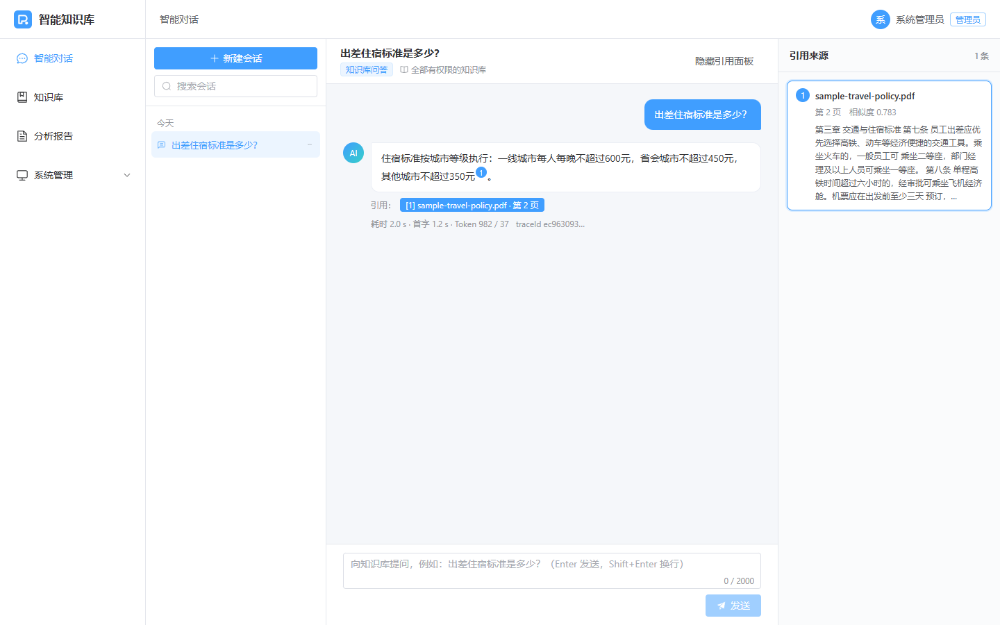
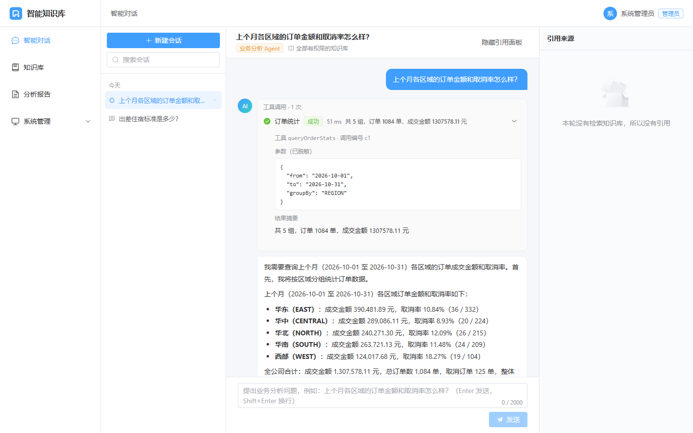
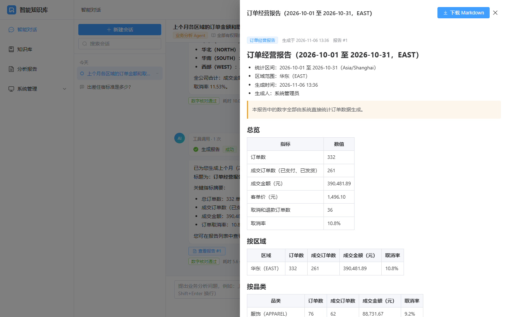
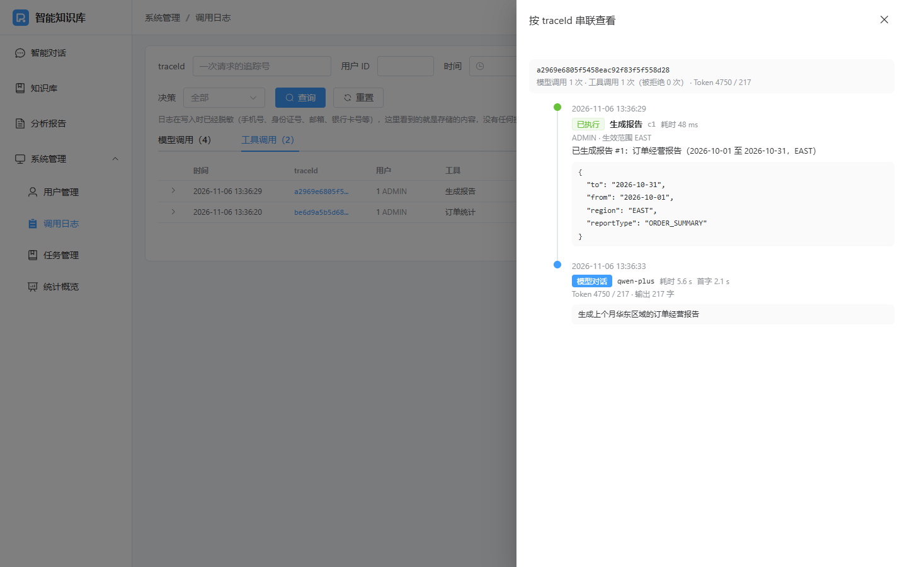
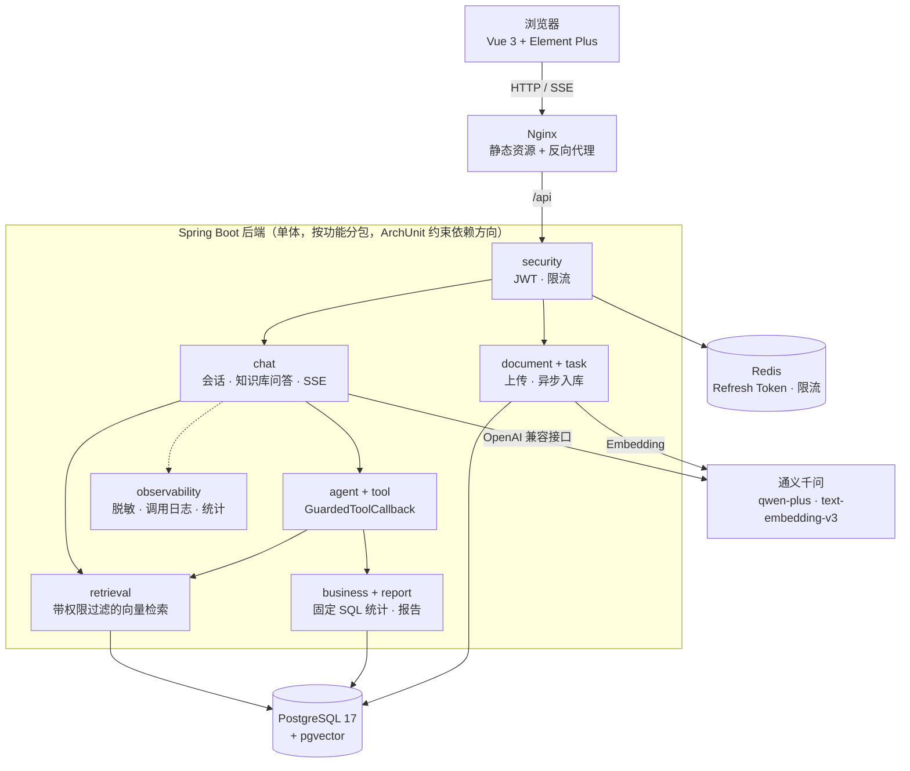
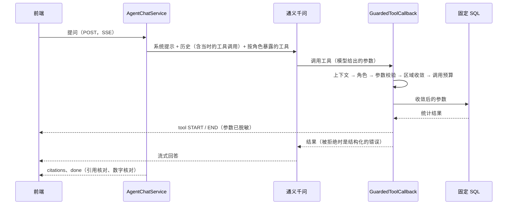

# 企业智能知识库与业务分析 Agent 平台

企业内部的知识库问答（RAG）和业务数据分析 Agent：
- 员工用自然语言查询公司制度，回答带可以核对的引用。
- 业务分析员让 Agent 调用统计工具，查询订单和异常事件、生成报告。每次工具调用都在服务端鉴权和审计。

**技术栈**：Java 21 · Spring Boot 4.1 · Spring AI 2.0 · PostgreSQL 17 + pgvector · Redis 7 · Vue 3 + TypeScript · Docker Compose。模型使用通义千问（qwen-plus、text-embedding-v3），通过 OpenAI 兼容接口调用。

这是一个个人项目，重点不在“把大模型接进来”，而在接进来之后的工程问题：权限边界、数据一致性、防止编造、可测试、可观测。每个阶段都写了测试；涉及模型效果的结论，都用真实模型分批实测过。

## 演示

| 知识库问答：流式回答，`[n]` 角标与右侧引用联动 | 业务分析 Agent：工具调用过程、脱敏后的参数、按区域统计 |
|---|---|
|  |  |
| **报告：数字全部由 SQL 统计结果生成，可下载 Markdown** | **管理后台：按 traceId 串联一次请求的模型调用和工具调用** |
|  |  |

## 功能

- **知识库**：知识库和成员权限（读者、编辑者、所有者）；PDF 上传后异步解析、切分、向量化；分片预览；检索调试（显示每个片段的相似度和是否达到阈值）。
- **知识库问答**：
  - 只在用户有权访问的知识库中检索，回答中的引用编号可以点击，对应到文档、页码和原文片段。
  - 检索不到相关资料时直接拒答，不调用模型。
- **业务分析 Agent**：
  - 模型按需调用 4 个工具：检索知识库、订单统计、异常事件统计、生成报告。
  - 工具调用过程实时推送到页面，回答中的数字经过核对。
- **三种角色**：普通员工（只能问知识库）、业务分析员（只能查看分配给自己的区域的数据）、管理员。
- **管理后台**：
  - 用户管理；模型和工具的调用日志，可以按 traceId 串联查看。
  - 重试耗尽的异步任务可以手动重试。
  - 统计概览：调用量、成功率、P50 / P95 延迟、Token 用量。

## 技术亮点

**1. 工具调用的权限在服务端逐次校验，而不是靠提示词**
- 模型只能“建议”调用哪个工具、传什么参数。每次调用都经过 `GuardedToolCallback`，按固定顺序执行：服务端上下文 → 角色 → 参数校验 → 区域范围收敛 → 调用预算 → 执行 → 审计。
- 身份来自服务端注入的上下文，模型改不了“我是谁、能看什么”。
- 模型按名字调用没有暴露给它的工具时，同样会被拒绝并记为 DENIED。集成测试用 spy 断言此时业务仓储一次都没有被调用。
- 统计 SQL 是固定的参数化查询，模型只能填日期和枚举值。
- 报告由 Java 根据 SQL 结果生成，集成测试断言报告里的数字等于直接执行 SQL 的结果。

**2. 防止模型编造：确定性校验兜底，用真实模型分批实测**
- **引用**：服务端解析回答中的 `[n]`，只承认本轮检索到的片段。迭代提示词后，合法引用从 6/15 提升到 15/15。
- **数字核对**：起因是实测中模型没有调用工具，就答出“华北上月异常事件 127 起”（真实是 56 起）。现在 Agent 回答里的每个数字，都必须能在本轮工具结果中找到出处。
  - 比对时容忍千分位、四舍五入、万 / 亿换算、可推算的占比、分钟和小时的换算。
  - 找不到出处的数字，会在回答末尾追加提示。
- **追问时不检索**：历史里只有“问题 + 回答”时，追问相关制度，模型会直接编出一段制度（复现 5/5）。
  - 在历史中还原当时的工具调用后，三批复测 15/15 都先检索。
  - 只改提示词的方案，反而让原本正常的场景退化，没有采用。

**3. 一致性与可靠性**
- 调用模型和 Embedding 期间，不持有数据库事务和连接。一轮问答拆成前后两个短事务；集成测试断言，Embedding 阻塞期间活跃连接数为 0。
- 文档入库用数据库任务表：
  - `FOR UPDATE SKIP LOCKED` 并发领取；
  - 租约 + fencing：执行者中途挂掉被接管后，旧执行者的提交会被拒绝；
  - 指数退避重试，重试耗尽后由管理员手动重试。
- 文件和数据库之间用补偿 + 定时对账保证一致。两个请求并发上传同一个文件，只会留下一条记录、一个文件。
- 流式输出（SSE）：
  - 带心跳；
  - 客户端断开就取消上游请求，并保存已生成的内容；
  - 进程崩溃后，残留的“生成中”消息由扫描器收尾。

**4. 安全**
- JWT + Refresh Token 轮换与重用检测：旧令牌再次出现时，撤销整个令牌族。另有登出黑名单、账号停用立即生效、Redis 令牌桶限流。
- 访问别人的资源统一返回 404，不泄露资源是否存在。
- 调用日志和应用日志（包括第三方库打印的异常堆栈）里的手机号、身份证号、邮箱等，在写入前脱敏。
- 前端渲染模型输出时关闭 HTML，并经过 DOMPurify 净化；Nginx 配置了 CSP。

**5. 可测试、可观测**
- 后端 323 个单元 / 接口切片 / 架构测试，82 个集成测试。集成测试用 Testcontainers 启动 pgvector 和 Redis，用 Fake 模型，不需要 API Key。前端另有 26 个单元测试。
- ArchUnit 约束模块之间的依赖方向，例如工具和 Agent 包不能直接执行 SQL。
- 通义流式分片回放测试：在本地回放通义风格的工具调用分片。把 Spring AI 降到 2.0.0 时，这个测试会失败，可以拦住升级带来的回归。
- traceId 贯穿一次请求；管理后台能按 traceId 串联查看，并给出 P50 / P95 延迟和 Token 用量。

## 架构



一次 Agent 提问：



设计文档：[docs/ARCHITECTURE.md](docs/ARCHITECTURE.md)（需求、模块划分、关键设计、数据库表、接口、测试方法、ADR）。各阶段的实现细节和实测数据：[docs/DEVLOG.md](docs/DEVLOG.md)。

## 快速开始（Docker）

只需要 Docker 和一个通义 DashScope 的 API Key：

```bash
cp .env.example .env
# 编辑 .env：填写 JWT_SECRET（openssl rand -base64 48）、DEMO_USER_PASSWORD（演示账号密码）和 AI_API_KEY
docker compose up -d --build
```

- 首次构建需要下载依赖，大约 5 分钟。国内网络可以在 `.env` 中设置 `MAVEN_MIRROR`、`NPM_REGISTRY`。
- 四个服务（postgres、redis、backend、web）都变为 healthy 后，打开 http://localhost:8088 。
- 用 `admin` / `analyst` / `user` 登录，密码都是 `DEMO_USER_PASSWORD`。`analyst` 只能查看华东区域的数据。

## 演示脚本

1. 用 `admin` 登录，在“知识库”中新建一个**公开**知识库，上传 [http/sample-travel-policy.pdf](http/sample-travel-policy.pdf)（虚构的差旅制度）。几秒后，文档状态变为“可用”。
2. “智能对话”中点示例问题“出差住宿标准是多少？”，再点回答里的角标，查看右侧的原文出处。
3. 新建“业务分析 Agent”会话，问“上个月各区域的订单金额和取消率怎么样？”，展开工具调用卡片查看参数和结果摘要。
4. 接着问“生成上个月华东区域的订单经营报告”，点“查看报告”，预览并下载。
5. 退出，用 `analyst` 登录，问“华北区域上个月有多少异常事件？”。模型只说明无权查看；即使模型发起调用，服务端也会拒绝并记入审计。
6. 用 `admin` 打开“系统管理 → 调用日志”，点任意 traceId，查看这次请求的模型调用和工具调用。

## 本地开发

```bash
docker compose up -d postgres redis        # 只启动基础设施
```

- **后端**：用 IntelliJ IDEA 的运行配置 **KbAgentApplication (local)**（位于 `.run/`），或者执行 `./mvnw spring-boot:run -Dspring-boot.run.profiles=local`。local profile 会读取项目根目录的 `.env`，并创建演示账号。
- **前端**：`cd frontend && npm install && npm run dev`，打开 http://localhost:5173 。`/api` 代理到 http://localhost:8080 ，后端在其他端口时，在 `frontend/.env.development.local` 中写入 `VITE_PROXY_TARGET`。
- **手动测试接口**：[http/kb-agent.http](http/kb-agent.http) 是 IntelliJ HTTP Client 的请求脚本，覆盖全部接口。
  - 在 `http/` 目录创建 `http-client.private.env.json`（已被忽略），内容为 `{ "local": { "password": "<DEMO_USER_PASSWORD>" } }`。
  - 编辑器上方的 **Run with** 选 `local`，然后从上到下依次执行。
- 直接点 `main` 方法旁边的运行按钮时，IntelliJ 生成的配置不带 `local` profile，`.env` 不会被读取，启动时会报 `The server requested SCRAM-based authentication, but no password was provided.`。在 Run → Edit Configurations 中把 Active profiles 设为 `local` 即可。

**Windows 上容器端口绑定失败**（`ports are not available ... forbidden by its access permissions`）：
- 原因：Hyper-V / WinNAT 会动态保留一些端口段。
- 排查：用 `netsh interface ipv4 show excludedportrange protocol=tcp` 查看保留段。
- 解决：在 `.env` 中把冲突的端口改成保留段之外的值，例如 `REDIS_PORT=16379`。

## 测试

```bash
./mvnw test                # 单元测试、接口切片测试、架构测试，不需要 Docker
./mvnw verify              # 另外运行集成测试，需要 Docker（Testcontainers），不需要 API Key
cd frontend && npm test    # 前端单元测试（Vitest）
cd frontend && npm run build   # 前端类型检查 + 打包
```

## 设计取舍

| 选择 | 原因 | 代价 |
|---|---|---|
| 单体，按功能分包，用 ArchUnit 约束依赖方向 | 一个人维护，部署简单；模块边界靠测试守住 | 不能按模块单独扩容 |
| 异步任务用数据库表（SKIP LOCKED + 租约 + fencing），不用消息队列 | 少一个组件；任务和业务数据在同一个事务里提交，不会丢 | 吞吐量受数据库限制，对文档入库足够 |
| 工具循环使用 Spring AI 自带的机制，权限在工具包装层校验 | 不重复造轮子；每次调用都经过同一个校验入口 | 依赖框架行为，用回放测试兜住升级风险 |
| 防编造用确定性的服务端校验兜底，不只靠提示词 | 实测提示词约束是概率性的，而且改提示词可能让其他场景退化 | 只能判断“有没有出处”，判断不了“算得对不对” |
| 对话历史存在自己的消息表，不用 Spring AI 的 ChatMemory | 需要保存引用、工具步骤、核对结果和状态，历史中还要还原工具调用 | 历史拼接要自己写 |
| SSE 用 POST + fetch，停止生成就是断开连接 | 能带请求体和 Authorization 头；服务端感知断开后取消上游请求 | 依赖单实例部署，没有跨实例的取消接口 |
| Token 存在 localStorage，配合关闭 HTML、DOMPurify 和 CSP | 不用 Cookie，就不需要处理 CSRF；多个标签页共享登录 | 页面脚本能读到令牌，所以 XSS 防护必须做足 |

完整的架构决策记录见 [ARCHITECTURE.md §11](docs/ARCHITECTURE.md)。

## 已知限制

- 只支持文本型 PDF，没有 OCR；检索只有向量检索，还没有关键词混合检索和 Rerank。
- 数字核对只在 Agent 模式下进行；知识库问答的原文数字写法太多样，误标的代价大于收益。
- 模型有时在调用工具之前，先输出自己的分析或调用计划。实测在提示词中禁止这样做，反而让模型更少调用工具，所以没有改。
- 没有历史时直接问很短的制度问题（例如“报销补助”），模型偶尔会反问具体想了解什么。
- 按单实例部署设计：停止生成依赖断开连接，没有单独的取消接口。
- 还没有 CI 流水线；前端 Element Plus 是全量引入，主包较大。

## 目录结构

```
.
├── Dockerfile                  后端镜像（多阶段构建，按 Spring Boot 分层）
├── docker-compose.yml          PostgreSQL + Redis；app profile 再加上后端和前端
├── .env.example                环境变量模板
├── docs/
│   ├── ARCHITECTURE.md         架构设计
│   ├── DEVLOG.md               各阶段的实现细节、实测数据和验收清单
│   └── images/                 README 截图
├── src/main/java/com/example/kbagent
│   ├── security, user          JWT、Refresh Token 轮换、登出黑名单；用户、角色、区域范围
│   ├── knowledge, document     知识库与成员权限；文档上传、删除、入库流水线（PDF 解析、切分、Embedding）
│   ├── storage, task           文件存储与孤儿文件对账；通用异步任务（领取、租约、fencing、重试）
│   ├── retrieval               带权限过滤的向量检索、检索调试
│   ├── chat                    会话与消息、一轮问答的通用流程（ChatRound）、知识库问答、SSE、引用解析、数字核对
│   ├── agent, tool             Agent 模式；4 个工具、GuardedToolCallback、权限矩阵、调用预算
│   ├── business, report        订单和异常事件的只读统计（固定 SQL）；报告生成与下载
│   ├── observability           脱敏、调用日志、日志查询与清理、统计概览
│   └── common, config          统一响应、错误码、限流、traceId；安全配置
├── src/main/resources/db/migration   Flyway：V1 建表，V2 演示业务数据，V3 数字核对结果
├── src/test/java/...           单元测试、接口切片测试、ArchUnit、集成测试
├── frontend/                   Vue 3 + TypeScript + Vite + Element Plus（Dockerfile、nginx.conf）
├── http/                       手动测试脚本（IntelliJ HTTP Client）和示例 PDF
└── spikes/                     M0 技术验证（独立的 Maven 工程）
```
